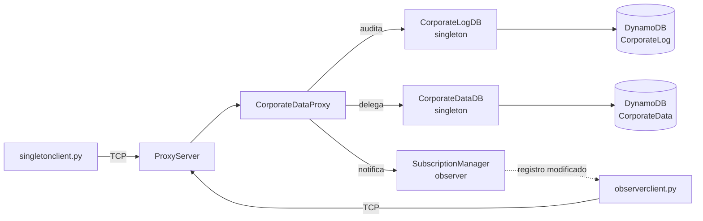
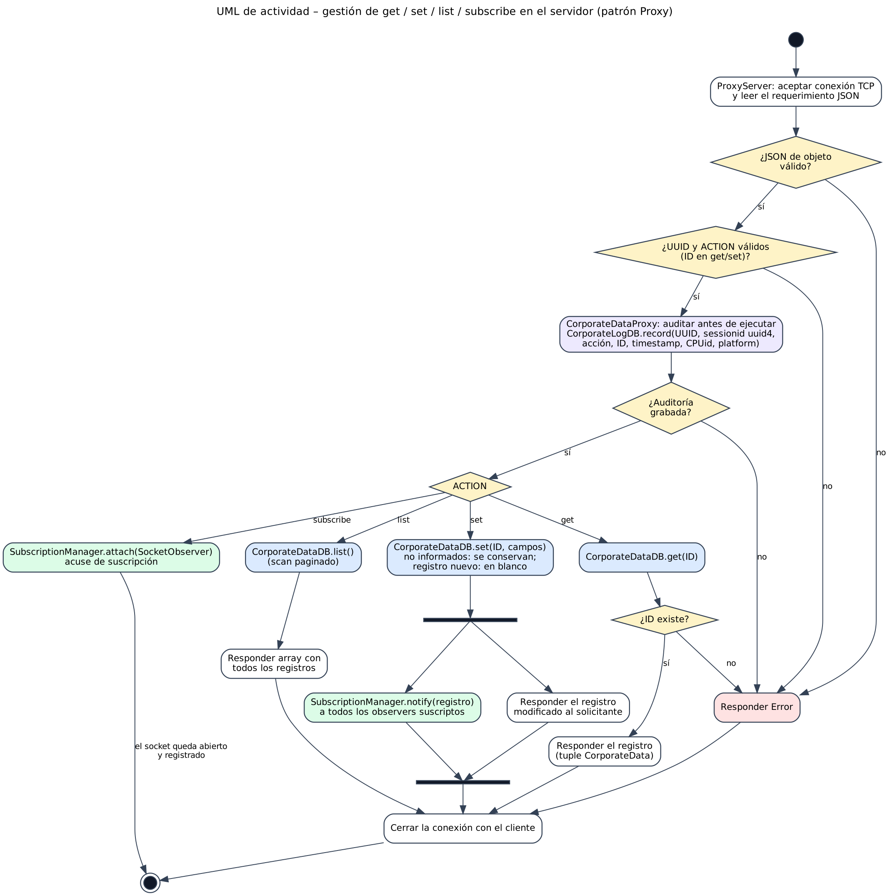
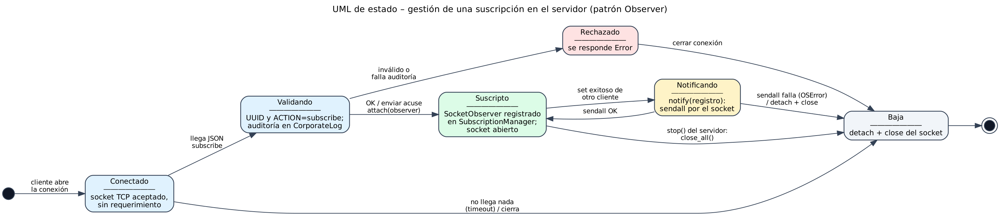

# TPFI - Patrón Proxy/Singleton/Observer en entorno AWS

Trabajo Práctico Final Integrador de **Ingeniería de Software II**
(UADER - Facultad de Ciencia y Tecnología). Versión 0.2.0 (build 2).

Servidor de aplicaciones que actúa como **proxy** de acceso a dos tablas de
Amazon DynamoDB, `CorporateData` (datos corporativos) y `CorporateLog`
(auditoría). El acceso físico a cada tabla se implementa como **singleton** y
los cambios se notifican en tiempo real a los clientes suscriptos mediante el
patrón **observer**.

## Contenido

1. [Estado de los entregables](#estado-de-los-entregables)
2. [Requisitos e instalación](#requisitos-e-instalación)
3. [Uso](#uso)
4. [Demostración paso a paso](#demostración-paso-a-paso)
5. [Protocolo](#protocolo)
6. [Arquitectura y patrones](#arquitectura-y-patrones)
7. [Auditoría en CorporateLog](#auditoría-en-corporatelog)
8. [Calidad y pruebas](#calidad-y-pruebas)
9. [Seguridad](#seguridad)
10. [Documentación del proyecto](#documentación-del-proyecto)
11. [Supuestos](#supuestos)
12. [Problemas frecuentes](#problemas-frecuentes)
13. [Licencia](#licencia)

## Estado de los entregables

| Entregable del enunciado | Estado |
|---|---|
| `singletonproxyobserver.py` (servidor TCP) | Hecho |
| `singletonclient.py` | Hecho |
| `observerclient.py` | Hecho |
| Singleton (CorporateData / CorporateLog), Observer, Proxy | Hecho |
| Auditoría en CorporateLog (UUID, sesión, acción, ID, timestamp, CPUid) | Hecho |
| UML de actividad (proxy) y de estado (observer) | Hecho (`docs/uml/`) |
| Tests unitarios y de aceptación (cobertura >= 85 %) | Hecho |
| ruff, black, mypy, pyright, bandit, pdoc | Hecho (ver [Calidad](#calidad-y-pruebas)) |
| CI/CD en GitHub Actions | Hecho (`.github/workflows/ci.yml`) |
| Esqueleto CookieCutter | Hecho (ver `docs/cookiecutter.md`) |
| `CONTEXT.md`, `CHANGELOG.md`, `VERSION`, `BUILD`, licencia MIT | Hecho |
| Prueba real contra AWS (set/get/list y auditoría) | Hecha |

## Requisitos e instalación

- Python 3.10 o superior.
- Una cuenta de AWS con acceso a las tablas `CorporateData` y `CorporateLog`
  (credenciales provistas por la cátedra).
- AWS CLI (solo para ejecutar `aws configure`).

### Linux / macOS

```bash
python3 -m venv venv
source venv/bin/activate
pip install -r requirements.txt
aws configure   # datos de IS2_TPFI_credentials.json (nunca subir a Git)
```

### Windows (PowerShell)

```powershell
python -m venv venv
venv\Scripts\Activate.ps1        # si falla: Set-ExecutionPolicy -Scope CurrentUser RemoteSigned
pip install -r requirements.txt
aws configure
```

`aws configure` pide cuatro datos: Access Key ID, Secret Access Key, región
(la indicada por la cátedra) y formato de salida (`json`). Quedan guardados en
tu usuario, fuera del repositorio.

Cada terminal nueva necesita activar el entorno virtual. En Windows, el
firewall puede pedir permiso la primera vez que arranca el servidor: hay que
permitirlo.

## Uso

Los tres programas se ejecutan desde la raíz del proyecto. Las llaves `{}`
indican parámetros opcionales.

### Servidor

```bash
python singletonproxyobserver.py {-p=port} {-v}
```

Escucha por defecto en `*:8080`. Si el puerto ya está ocupado (por ejemplo,
por una segunda copia del servidor), informa el error y termina con código 1.

### Cliente de consulta y actualización

```bash
python singletonclient.py -i=input.json {-o=output.json} {-s=hostname} {-p=port} {-v}
```

Envía el requerimiento del archivo `input.json` y muestra la respuesta por
pantalla o, si se indica `-o`, la guarda en ese archivo. Por defecto se
conecta a `localhost:8080`.

### Cliente observador

```bash
python observerclient.py {-s=hostname} {-p=port} {-o=output.json} {-r=segundos} {-v}
```

Se suscribe al servidor y queda esperando. Cada vez que otro cliente hace un
`set`, muestra el registro modificado por pantalla y lo agrega a `-o` (una
línea JSON por notificación). Si el servidor no está o se corta la conexión,
reintenta cada 30 segundos (configurable con `-r`) y se vuelve a suscribir.

### Opciones comunes y códigos de salida

| Opción | Significado |
|---|---|
| `-v` | Activa los mensajes de depuración por salida estándar |
| `-s` | Servidor al que conectarse (por defecto `localhost`) |
| `-p` | Puerto TCP (por defecto `8080`) |
| `-o` | Archivo de salida |

| Código | Significado |
|---|---|
| `0` | Correcto |
| `1` | Servidor inalcanzable (cliente) o imposible escuchar (servidor) |
| `2` | Argumentos o archivo de entrada inválidos |
| `3` | El servidor respondió con error |

### Formato de `input.json`

```json
{"UUID": "123456789", "ACTION": "get", "ID": "UADER-FCyT-IS2"}
{"UUID": "123456789", "ACTION": "list"}
{"UUID": "123456789", "ACTION": "set", "ID": "UADER-FCyT-IS2", "cp": "3260", "sede": "FCyT"}
```

(Cada línea es un archivo distinto.) Reglas:

- `UUID` y `ACTION` son obligatorios. `ACTION` es `get`, `set` o `list`.
- `get` y `set` requieren además `ID`.
- En `set`, los campos no informados **no se modifican**. Si la clave no
  existe, se crea el registro con los campos no informados en blanco.
- Campos del registro: `id`, `cp`, `CUIT`, `domicilio`, `idreq`, `idSeq`,
  `localidad`, `provincia`, `sede`, `seqID`, `telefono`, `web`.

> En PowerShell, `-i=input.json` puede interpretarse mal. Usar comillas
> (`"-i=input.json"`) o la forma con espacio (`-i input.json`). Para crear el
> JSON, usar un editor o `Set-Content` con comillas simples; pegarlo directo
> en la consola produce errores.

## Demostración paso a paso

Se necesitan tres terminales con el entorno virtual activado, dentro de la
carpeta del proyecto.

**Terminal 1: servidor**

```powershell
python singletonproxyobserver.py -v
```

**Terminal 2: observer** (queda esperando)

```powershell
python observerclient.py -v
```

**Terminal 3: cliente**

```powershell
Set-Content set1.json '{"UUID": "123456789", "ACTION": "set", "ID": "UADER-FCyT-IS2", "cp": "3260", "sede": "FCyT"}'
Set-Content get1.json '{"UUID": "123456789", "ACTION": "get", "ID": "UADER-FCyT-IS2"}'
Set-Content list1.json '{"UUID": "123456789", "ACTION": "list"}'

python singletonclient.py "-i=set1.json"     # el observer muestra el registro
python singletonclient.py "-i=get1.json"
python singletonclient.py "-i=list1.json"
```

Un `get` de un ID inexistente devuelve un registro con `"STATUS": "Error"` y
el cliente termina con código 3. Cada operación deja una fila en
`CorporateLog` (ver [Auditoría](#auditoría-en-corporatelog)).

## Protocolo

JSON en UTF-8 sobre TCP, un mensaje por línea. El cliente envía el
requerimiento y el servidor responde según la acción:

| Acción | Respuesta | Conexión |
|---|---|---|
| `get` | el registro de CorporateData | se cierra |
| `set` | el registro modificado (también se retransmite a los observers) | se cierra |
| `list` | array con todos los registros | se cierra |
| `subscribe` | acuse `{"UUID", "ACTION": "subscribe", "STATUS": "OK"}` y luego un registro por cada `set` | queda abierta |
| (cualquier falla) | `{"UUID", "ACTION", "STATUS": "Error", "ERROR": "..."}` | se cierra |

Un requerimiento sin los datos mínimos, con JSON inválido o con una acción
desconocida recibe la respuesta de error y **no** modifica ninguna tabla ni
genera auditoría. El servidor atiende cada conexión en un hilo propio, por lo
que un cliente defectuoso no afecta a los demás.

## Arquitectura y patrones



| Patrón | Dónde | Cómo se cumple |
|---|---|---|
| Singleton | `tpfi/singleton.py`, `tpfi/db/*.py` | `SingletonMeta` (thread-safe); `CorporateDataDB` y `CorporateLogDB` la usan, por lo que hay una única instancia de acceso a cada tabla |
| Observer | `tpfi/observer.py` | `Observer` (clase abstracta), `SocketObserver`, `Subject` y `SubscriptionManager`; los suscriptores caídos se eliminan solos |
| Proxy | `tpfi/proxy.py`, `tpfi/service.py` | `CorporateDataProxy` y `CorporateDataDB` implementan la misma interfaz `DataService`; el proxy audita antes de delegar y notifica después de un `set` |

### Diagramas UML

- Diagrama de actividad del proxy: [`docs/uml/proxy_activity.png`](docs/uml/proxy_activity.png)
- Diagrama de estado del observer: [`docs/uml/observer_state.png`](docs/uml/observer_state.png)





### Estructura del proyecto

```
singletonproxyobserver.py  singletonclient.py  observerclient.py   (programas)
tpfi/
  config.py logging_setup.py singleton.py protocol.py service.py net.py
  observer.py proxy.py server.py clients.py cliargs.py
  db/data_table.py db/log_table.py db/keys.py
  apps/        (main() de cada programa)
tests/         (unitarios, de servidor/cliente y de aceptación)
docs/uml/      (diagramas)
.github/       (CI, plantillas de issues y de pull request)
```

## Auditoría en CorporateLog

Cada requerimiento válido que atiende el proxy genera un registro en
`CorporateLog` **antes** de ejecutarse:

| Campo | Contenido |
|---|---|
| clave de la tabla | identificador único del registro (UUID v4 generado por el servidor; el nombre de la clave se consulta a DynamoDB) |
| `UUID` | identificador enviado por el cliente en el requerimiento |
| `sessionid` | identificador único de la sesión de atención |
| `action` | `get`, `set`, `list` o `subscribe` |
| `timestamp` | fecha y hora UTC (ISO 8601) |
| `CPUid` | identificador de la máquina que atendió el pedido |
| `platform`, `machine`, `processor`, `node` | datos del equipo servidor |
| `item_id` | `ID` consultado o modificado (si corresponde) |

## Calidad y pruebas

```bash
black .                          # formatea (ejecutar primero)
ruff check .                     # estilo PEP 8 / PEP 257
black --check .
mypy                             # tipos (modo estricto)
pyright
pytest                           # exige cobertura >= 85 %
bandit -r tpfi -c pyproject.toml # seguridad
pdoc tpfi -o docs/api            # documentación de la API
```

El workflow `.github/workflows/ci.yml` ejecuta todo lo anterior en cada
push y pull request y publica la documentación generada como artefacto.

### Qué se prueba

- **Unitarias y de integración:** tablas DynamoDB falsas en memoria y sockets
  reales en localhost (no tocan AWS).
- **Aceptación** (`tests/test_acceptance.py`): lanzan los tres programas como
  procesos con los comandos del enunciado y verifican el impacto en
  `CorporateData` y `CorporateLog`:
  - camino feliz de `get`, `set` y `list`, incluidas las entradas de auditoría;
  - argumentos mal formados en cada uno de los tres programas;
  - requerimientos sin los datos mínimos;
  - cliente con el servidor caído, y observer que reintenta;
  - doble arranque del servidor en el mismo puerto.
- **Patrones:** tests específicos verifican el singleton (una sola instancia,
  segura entre hilos), el observer (interfaz abstracta, baja de suscriptores
  caídos) y el proxy (misma interfaz que el sujeto real, auditoría antes de
  delegar).

## Seguridad

- Las credenciales de AWS **no** forman parte del repositorio. El
  `.gitignore` excluye `IS2_TPFI_credentials.json`, `*credential*`, `*secret*`,
  `*.key`, `*.pem`, `.env*`, `.aws/`, el entorno virtual y el material de
  la cátedra (`referencia/`).
- Antes de cada commit conviene revisar `git status` y buscar claves con
  `git grep -n -i -E "AKIA|ASIA|aws_secret|secret_access_key"`.
- `bandit` analiza el código en cada ejecución del CI.
- Si alguna clave llegara a subirse, borrar el archivo no alcanza: hay que
  pedir a la cátedra que la rote.

## Documentación del proyecto

| Archivo | Contenido |
|---|---|
| `CONTEXT.md` | Registro de los prompts y decisiones tomadas con ayuda de IA |
| `CHANGELOG.md` | Historial de cambios por versión |
| `VERSION`, `BUILD` | Versión (0.2.0) y número de compilación |
| `docs/uml/` | Diagramas UML (`.dot`, `.png`, `.svg`) |
| `docs/cookiecutter.md` | Cómo se usó CookieCutter y qué se adoptó de la plantilla |
| `requirements.txt` | Dependencias de ejecución y de desarrollo |
| `LICENSE` | Licencia MIT |

## Supuestos

- El nombre de la clave de partición de ambas tablas se consulta a DynamoDB
  (`key_schema`); si la cuenta no permite `DescribeTable`, se usa `id`.
- Los campos de auditoría adicionales (`CPUid`, `platform`, `machine`,
  `processor`, `node`) son atributos extra; DynamoDB no exige un esquema fijo.
- `observerclient` agrega cada notificación al archivo `-o` como una línea
  JSON, sin sobrescribir lo anterior.
- El servidor mantiene abiertos solo los sockets de los observers; los
  clientes de consulta reciben su respuesta y la conexión se cierra.

## Problemas frecuentes

| Síntoma | Causa y solución |
|---|---|
| `ModuleNotFoundError: boto3` | El entorno virtual no está activo (`venv\Scripts\Activate.ps1`) |
| `Unable to locate credentials` | Falta ejecutar `aws configure` |
| `ParserError` al pegar un JSON en PowerShell | Crear el archivo con un editor o con `Set-Content` y comillas simples |
| El cliente tarda unos segundos en fallar sin servidor | En Windows, una conexión rechazada demora cerca de 2 s |
| `No se puede escuchar` al iniciar el servidor | Ya hay otro servidor en ese puerto; usar `-p` con otro número |
| Advertencias `LF will be replaced by CRLF` en git | Son inofensivas en Windows |

## Licencia

MIT. Ver `LICENSE`.